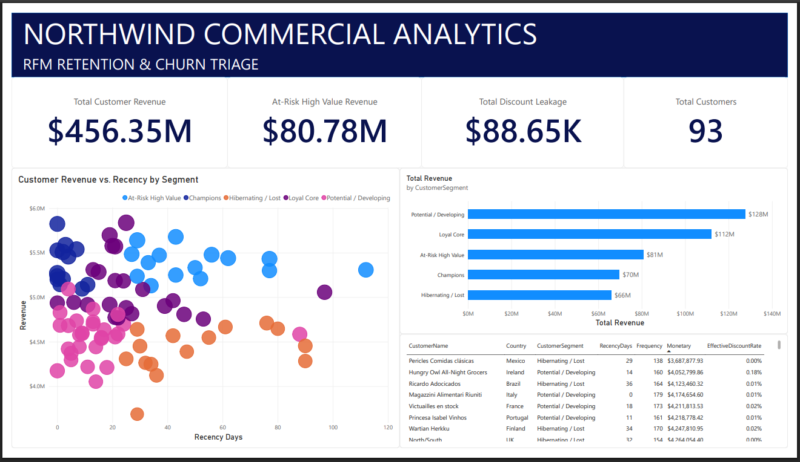
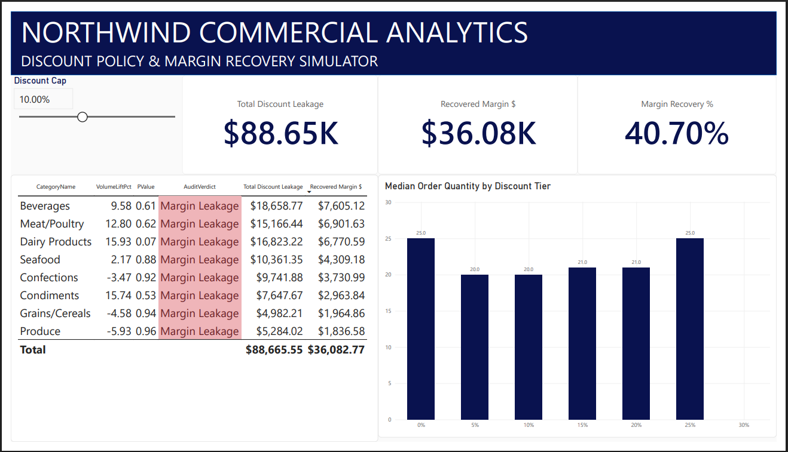

# Northwind Commercial Analytics: RFM Retention & Discount Margin Engine

An end-to-end commercial analytics solution combining **SQLite**, **Python (Pandas/SciPy)**, and **Power BI** to diagnose customer churn risk and quantify gross margin leakage across discount tiers.

---

## Executive Summary & Key Findings

* **$456.35M Total Net Revenue** across **93 active accounts**, with **$80.78M (17.7%)** concentrated in **At-Risk High Value** customers requiring immediate account retention outreach.
* **$88.65K in Direct Discount Leakage** identified across product categories, with **Beverages ($18.66K)**, **Dairy Products ($16.82K)**, and **Meat/Poultry ($15.17K)** accounting for over 57% of total margin erosion.
* **Zero Statistically Significant Volume Lift from Discounting:** Hypothesis testing across all 8 product categories confirmed $p > 0.05$ ($p = 0.07$ to $0.96$) for order quantity lift. Median order size sits at **25.0 units at 0% discount** versus **20.0–21.2 units across 5%–20% discount tiers**, proving discounts erode unit margin without driving incremental bulk purchasing.
* **Policy Simulation Impact:** Capping discretionary discounts at **10.0%** recovers **$36.08K (40.70%)** of leaked margin while preserving order volume.

---

## Dashboard Preview

### 1. RFM Retention & Churn Triage

* **Customer Segmentation:** Classifies accounts into *Champions*, *Loyal Core*, *Potential / Developing*, *At-Risk High Value*, and *Hibernating / Lost* using composite RFM scoring.
* **Account Action Table:** Ranks accounts by monetary value, recency, order frequency, and effective discount rate to prioritize commercial outreach.

### 2. Discount Policy & Margin Recovery Simulator

* **What-If Parameter (`Discount Cap`):** Dynamically recalculates recoverable gross margin dollars and recovery percentage across any selected discount ceiling (`0%` to `25%`).
* **Category Audit Matrix:** Flags margin-leaking categories alongside statistical volume lift (`VolumeLiftPct`) and significance testing (`PValue`).

---

## Architecture & Tech Stack

1. **Data Layer (`SQLite`):** Engineered `vw_RFM_and_Margin` to compute customer-level Recency, Frequency, Net Monetary Value, RFM quintile scores, and effective discount rates directly in SQL.
2. **Statistical Audit (`Python`):** Evaluated order-line elasticity across discount tiers (`0%–25%`) and generated category-level hypothesis tests (`py_category_margin_audit`, `py_discount_tier_summary`).
3. **BI & Simulation Layer (`Power BI`):** Connected via 64-bit SQLite ODBC driver with custom DAX measures driving dynamic What-If discount cap simulations:

```dax
Recovered Margin $ = 
SUMX(
    'Order Details',
    VAR ExcessDiscount = MAX(0, 'Order Details'[Discount] - 'Discount Cap'[Discount Cap Value])
    RETURN 'Order Details'[UnitPrice] * 'Order Details'[Quantity] * ExcessDiscount
)

Margin Recovery % = 
DIVIDE([Recovered Margin $], [Total Discount Leakage], 0)
